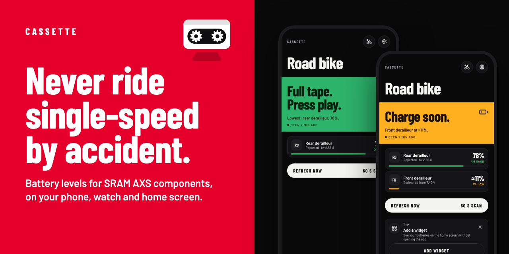
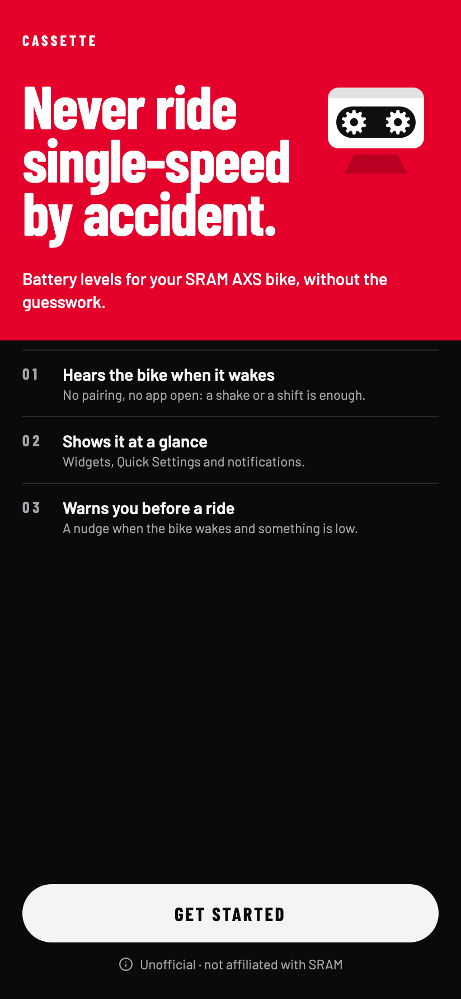
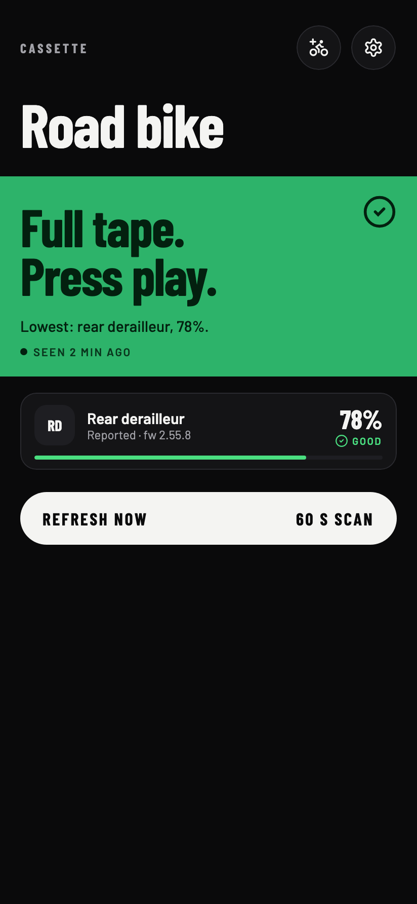
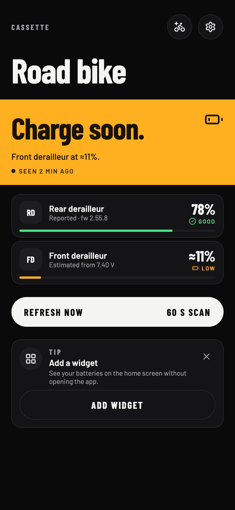
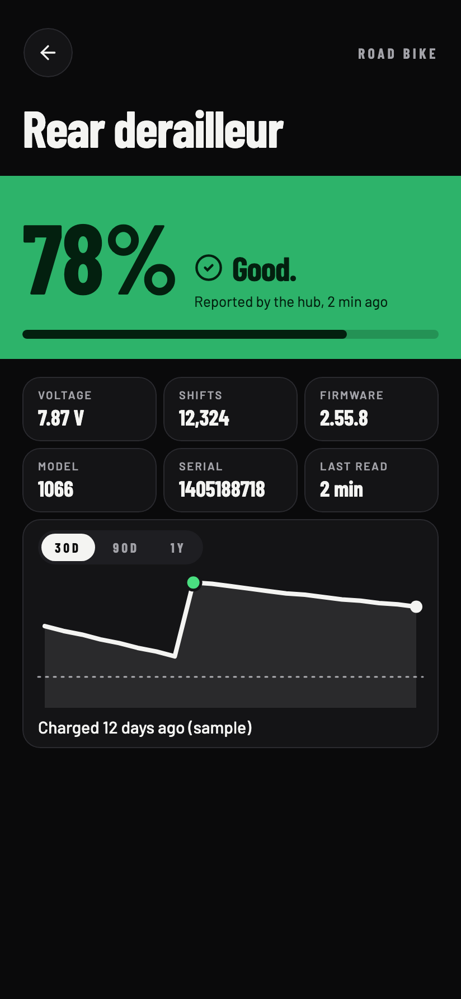

<p align="center">
  
</p>

# Cassette

[](https://github.com/r0adkll/cassette/actions/workflows/build.yml)

**Battery levels for your SRAM AXS bike, without opening SRAM's app.** Cassette listens for your
components' Bluetooth broadcasts when the bike wakes, reads the rear derailleur's system tables, and shows
every battery on your phone, home screen, watch and notifications.

> [!NOTE]
> Cassette is **unofficial** and **not affiliated with SRAM**. The protocol is reverse engineered and has been
> validated on one Red AXS bike. Other groupsets should work, and anything unknown shows up in Diagnostics.

<p align="center">
  
  
  
  
</p>

## What it does

- **Hears the bike when it wakes.** No pairing and no app open: a shake or a shift is enough.
- **Shows each component's status** (good, low, charge now) the way SRAM reports it, with a percentage where
  the component gives one and a marked **≈ estimate** from voltage where it doesn't.
- **Warns you before a ride.** A heads-up when the bike wakes and something is already low, an alert when a
  component drops to low or charge now, and a reminder when a bike hasn't been seen for a while.
- **Puts it everywhere you look:** home screen widgets, a Quick Settings tile, Wear OS tiles and
  complications, iPhone widgets and a Live Activity while a refresh runs.
- **Keeps a history** per component: a 30-day, 90-day or 1-year chart that marks charges and coin-cell
  swaps, beside its voltage, shift count and firmware.
- **Shows its working.** Diagnostics holds the raw adverts, nearby SRAM-looking devices, hub table dumps,
  ride tests and scan profiles, in every build.

## Platforms

| Platform | Status |
|---|---|
| Android (12+) | The main app: phone, foldables and tablets, widgets, Quick Settings tile, notifications |
| Wear OS | Bike list, tile and complications, reading the phone's data |
| iPhone (iOS 17+) | In progress: the shared screens, widgets and Live Activity; Bluetooth not yet tested on a device |

## Hardware

Validated on a Red AXS road bike: rear and front derailleurs, both drop-bar shifters and a Quarq DZero power
meter. Mountain, Eagle Transmission, droppers, pods and blips are decoded from prior art but haven't been
seen by the app yet. If you have one, a diagnostics share or a [bug report](https://github.com/r0adkll/cassette/issues/new?labels=bug)
helps.

## Building

Kotlin Multiplatform with Compose Multiplatform, [Circuit](https://github.com/slackhq/circuit),
[Metro](https://github.com/ZacSweers/metro) and SQLDelight.

```sh
./gradlew :app:android:assembleDebug      # Android phone app
./gradlew :app:wear:assembleDebug         # Wear OS app
scripts/ios-run                           # iOS app on a Simulator (needs Xcode and xcodegen)
```

You can check the UI without a device: `./gradlew :common:compose:jvmTest` renders the design system to
`common/compose/build/gallery/`, and each feature's `jvmTest` renders its screens to `build/screens/`
(for example `./gradlew :features:bikes:ui:jvmTest`).

Formatting is [ktfmt](https://github.com/facebook/ktfmt) (Google style): `scripts/ktfmt --format`.

## Docs

- [Product](docs/product.md): what Cassette is for and how it presents batteries
- [Architecture](docs/architecture.md): modules and how they fit
- [Protocol](docs/protocol.md): what we know about AXS and Quarq over Bluetooth LE, and where it came from
- [Decisions](docs/decisions/): one record per product, design and architecture decision
- [Roadmap](docs/roadmap.md) and [Changelog](CHANGELOG.md)

## Credits

Built on public work by [tarekrached/esphome-sram-axs](https://github.com/tarekrached/esphome-sram-axs) and
[karl-petter/sram-axs-for-ha](https://github.com/karl-petter/sram-axs-for-ha). Type is
[Barlow](https://github.com/jpt/barlow) and [JetBrains Mono](https://www.jetbrains.com/lp/mono/) (OFL), icons
are [Lucide](https://lucide.dev) (ISC); their licences are in [`thirdparty/licenses`](thirdparty/licenses).

SRAM, AXS, Red, Eagle and Quarq are trademarks of SRAM, LLC. Cassette contains no SRAM artwork, logos,
fonts or code.

[Privacy policy](https://thescavengers.software/cassette/privacy) ·
[Terms of service](https://thescavengers.software/cassette/terms)
